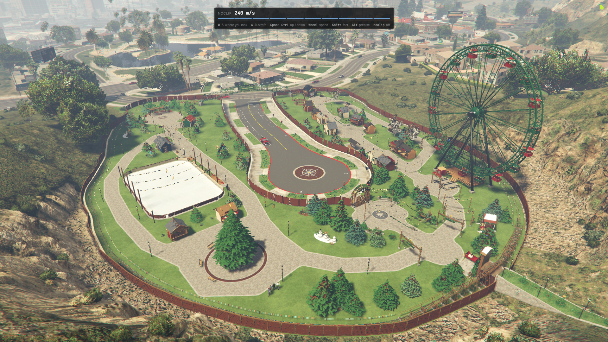
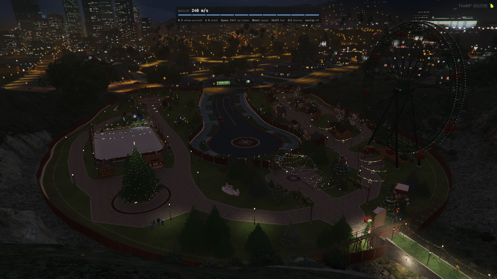
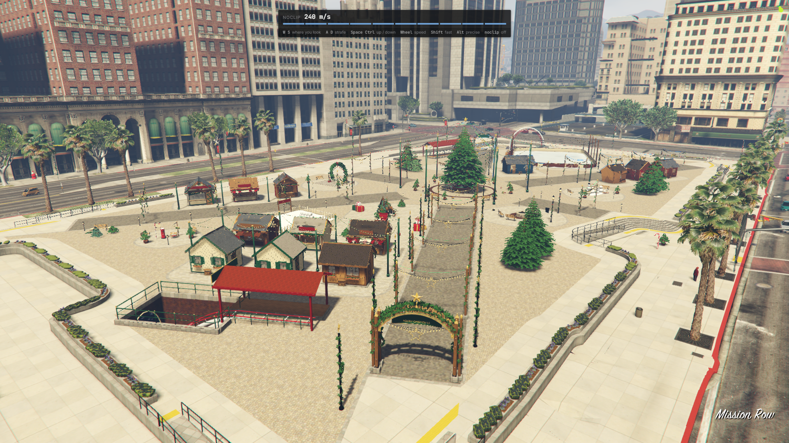
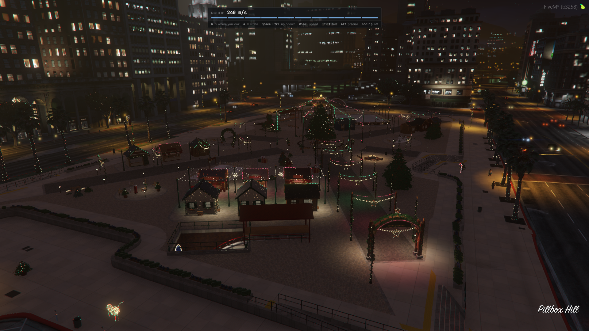

# [FREE] [MAP] Mirror Park Christmas

Welcome to Mirror Park Christmas.

A Christmas village on the hill above Mirror Park: market cabins, an ice rink, a Ferris wheel, a steam train, a snow globe hidden in the hill, a sleigh coaster to get you back out, and Santa himself. Downtown, Legion Square gets the same treatment, with a coaster underneath it.



**[Watch the video](images/video.mp4)**

> [!CAUTION]
> **STILL BEING WORKED ON.** This map is a work in progress and things will keep changing.
> If you're going to complain that it isn't ready, don't use it yet.

## Download

| Version | File | What's inside |
|-|-|-|
| **Furnished** | [olentrix_mirror_park_christmas_furnished_v2.0.3.zip](https://github.com/OlentrixAssets/olentrix_mirror_park_christmas/releases/download/v2.0.3/olentrix_mirror_park_christmas_furnished_v2.0.3.zip) | Everything, as shown, plus Legion Square and the city-wide extras |
| **Unfurnished** | [olentrix_mirror_park_christmas_unfurnished_v2.0.3.zip](https://github.com/OlentrixAssets/olentrix_mirror_park_christmas/releases/download/v2.0.3/olentrix_mirror_park_christmas_unfurnished_v2.0.3.zip) | The buildings, paths, fence, rink, wheel and snow globe, empty for you to furnish |
| **Flat with fence** | [olentrix_mirror_park_christmas_flat_with_fence_v2.0.3.zip](https://github.com/OlentrixAssets/olentrix_mirror_park_christmas/releases/download/v2.0.3/olentrix_mirror_park_christmas_flat_with_fence_v2.0.3.zip) | The levelled hill with the fence round it |
| **Flat** | [olentrix_mirror_park_christmas_flat_v2.0.3.zip](https://github.com/OlentrixAssets/olentrix_mirror_park_christmas/releases/download/v2.0.3/olentrix_mirror_park_christmas_flat_v2.0.3.zip) | Just the levelled hill |
| **Props** | [olentrix_mirror_park_christmas_props_v2.0.3.zip](https://github.com/OlentrixAssets/olentrix_mirror_park_christmas/releases/download/v2.0.3/olentrix_mirror_park_christmas_props_v2.0.3.zip) | The market's props on their own, to place anywhere |

Or hit **Code → Download ZIP** to grab all four map versions, each in its own folder.

> [!WARNING]
> Only run one version, they're the same hill and will fight.


**Questions, bugs, screenshots?** Come say hi on [Discord](https://discord.gg/FTZTtQRsfR).

<details>
<summary><b>Features</b></summary>

- 15 wooden market cabins, each with its own stall and stock
- Ice rink with a viewing terrace, a skate hire and changing decks, and you can actually skate on it
- An ice show: two skaters put on a full routine to music
- Ferris wheel you can ride, a main Christmas tree and a fireside lounge
- The Christmas Express: a small steam train you can ride round the whole market
- A snow globe at the end of a lantern-lit tunnel through the hill, with a snowy village inside
- Santa's Sleigh Run: a roller coaster from the snow globe out over the hill and back
- Santa's grotto: sit on Santa's lap or stand beside him, pick a pose, and an elf counts you down for the photo
- A wandering elf who wants to know if you've been naughty or nice. Choose carefully
- Carol singers by the big tree, and a Letters to Santa postbox
- Sit on every bench, sofa and chair in the market
- Music, carols, bells and a crackling fire near the attractions
- An evening light ceremony that lights the village up landmark by landmark
- No random NPCs or traffic wandering through the market
- Legion Square downtown as a Christmas plaza: cabins, an ice rink, tree islands, seats to sit on and carols across the square
- Neon lights in the plaza that pulse on the beat of the music
- The Legion Plunge: a coaster that dives under the square and comes back out
- A snowball corner, and a grate in the pavement you might not want to open
- `xmasintro`: a camera tour of the market and the square, timed to a song
- No framework, no database

```
/tp 1372.00, -735.00, 66.60
/tp 196.24, -933.36, 29.20
```

</details>

<details>
<summary><b>Preview</b></summary>





</details>

<details>
<summary><b>Installation</b></summary>

It's literally like every other FiveM map resource. Drop the `[olentrix_mirror_park_christmas]` folder into your resources folder, add `ensure [olentrix_mirror_park_christmas]` to your server.cfg, and restart your server.

Congratulations, you now own Christmas.

Legion Square is its own folder in the furnished version, `[olentrix_mpc_legion]`. Copy it in as well and add `ensure [olentrix_mpc_legion]`. It needs `olentrix_mpc_houses` from the extras folder.

</details>

<details>
<summary><b>Optional extras</b></summary>

The furnished version also comes with an `[olentrix_mpc_extras]` folder. Copy it in too and add a line for each one you want:

```
ensure olentrix_mpc_houses
ensure olentrix_mpc_houses_snow
ensure olentrix_mpc_trees
ensure olentrix_mpc_streets
```

- **olentrix_mpc_houses:** lights, wreaths, garlands and yard decorations on houses around the city, plus a few bridges and squares
- **olentrix_mpc_houses_snow:** snow for those decorations, only if your server runs snow
- **olentrix_mpc_trees:** Christmas bulbs in the game's own trees and palms, map-wide
- **olentrix_mpc_streets:** decorations on street lights, signals, bus shelters, benches and more, map-wide

</details>

<details>
<summary><b>How it works</b></summary>

- **Christmas Express:** walk up to a coach at the station and press **E** to board, **E** again to step off.
- **Santa's Sleigh Run:** the sleigh waits inside the snow globe. Press **E** to ride, one rider at a time.
- **Ferris wheel:** board on the platform and press **E**. One full turn, **Backspace** to get off at the bottom.
- **Ice skating:** grab skates at the Skate Hire counter with **E**, then press **G** on a changing deck to put them on or take them off.
- **Ice show:** press **E** at the terrace to start it. The ice clears a minute before.
- **The elf:** press **E** to talk, then **E** for nice or **G** for naughty.
- **Santa's grotto:** press **E** to pick a photo spot, **E** for a pose, **G** for the photo, **H** to whisper your wish and **Backspace** to hop off.
- **Letters to Santa:** letters are kept on the server. Staff read the latest with the `santaletters` command (ace `command.santaletters`).
- **The Legion Plunge:** walk into the entrance canopy in the north-west corner of the square and press **E**.
- **Snowballs:** press **E** at the snowball corner in the south-west of the square.
- **The grate:** press **E** at the grate on the north-east pavement. If you dare.
- **Intro:** run the `xmasintro` command to watch the camera tour. **Backspace** skips it.
- **Light ceremony:** runs on its own at 18:00, 20:00 and 22:00 game time if your server uses Renewed-Weathersync. Staff can also start it with the `xmasceremony` command (ace `command.xmasceremony`).

</details>

<details>
<summary><b>Props</b></summary>

Just want the props for your own build? The props zip is a single resource, `olentrix_mpc_props`, with the market's props and their textures and no map or scripts. Don't run it alongside the full map, which already has every one of them.

</details>

<details>
<summary><b>Textures</b></summary>

All textures are conveniently packed into YTD files, making them easy to modify, customize, or completely ruin with your own questionable decisions.

</details>

<details>
<summary><b>Heads up</b></summary>

This map replaces the hill court and road above Mirror Park. If you're running another map in that same spot, they're going to fight, and nobody wins.
The Legion folder rebuilds Legion Square, so anything else that changes that square will fight with it.
The trees and streets extras replace the game's own tree, palm and street prop models, so anything else that replaces those will fight with them too.

```
/tp 1372.00, -735.00, 66.60
```

</details>

<details>
<summary><b>License</b></summary>

Free to use and edit on your own server. No resale, re-uploading, or sharing.

</details>

Remember, don't lick the frozen lamp posts, stay off the ice during the show, and for the love of everything holy, stop asking why your map isn't working when you forgot to ensure the resource.

Good day, you magnificent deviants.

---

| | |
|-|-|
| Code is accessible | Yes |
| Subscription-based | No |
| Lines (approximately) | 6,200 |
| Requirements | None, standalone |
| Support | Yes |

**Made with:** Blender 5.2.3 · Sollumz 2.9.0 · CodeWalker (Latest Release) · DirectXTex texconv 2026.5.8.1 · OpenIV 4.1
